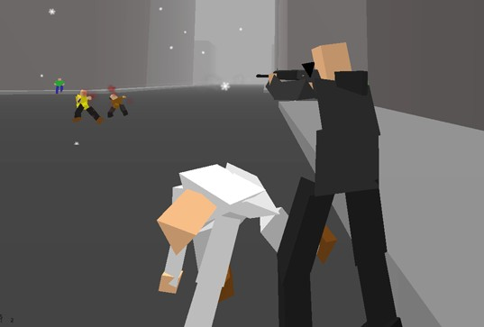

# Black Shades


Java port created as a hobby

Try to keep your VIP (the guy in white) alive as long as possible. The assassins will all try to shoot or stab him to death. You must do all you can to prevent this. Your reputation has preceded you, so the VIP has absolute confidence in your abilities and will completely ignore all the assassins. When an assassin is aiming at your VIP with a gun, you will psychicly see a line of sight extending from him to your VIP. This line will narrow and redden until it disappears and the assassin fires. Depending on the situation it may be best just to shoot the assassin(s), or to dive and tackle the VIP to the ground to avoid the bullet. Unfortunately your psychic powers do not show the line of sight of knife-wielding assassins.

## Build instructions
To compile you must have JDK 11 or later installed, as well as the ANT compiler (version 1.7 or later).

Under Mac OS X, Linux, FreeBSD or Windows simply execute this command in the terminal or command prompt in the project directory

```
ant
```
To run the game on Unix-like operating systems, you must execute the following commands.
```
cd build
chmod 777 Unix.sh
./Unix.sh
```
If you are on Windows, simply go into the build folder and double-click the Windows.bat file.

## Controls
WASD = walk\
shift = run\
mouse = look\
control = crouch/zoom\
click = fire (while aiming) or smash (while running) or pick up gun (while crouching over a body and not aiming) or disarm (while not aiming)\
q = aim or un-aim (important for picking up guns)\
r = reload\
e = psychic aim\
z = toggle soul release\
space = dive (while running forwards)

keys for debug mode:

tab = 3rdperson toggle\
f = Force Pushª :)\
shift-x = switch weapons

Thats it

## Documentation
* [doc/Readme](doc/Readme): a detailed description of how to
  play and configure the game
* [doc/authors.txt](doc/authors.txt): a list of people who made this game possible
* [doc/uDevGame_License](doc/uDevGame_License): a description of licensing and exceptions
* [doc/lwjgl-license.md](doc/lwjgl-license.md): LWJGL license

## The original source code
The code writen in C++ made by David Rosen can be found in this page [Black Shades Page](https://www.icculus.org/blackshades/).
